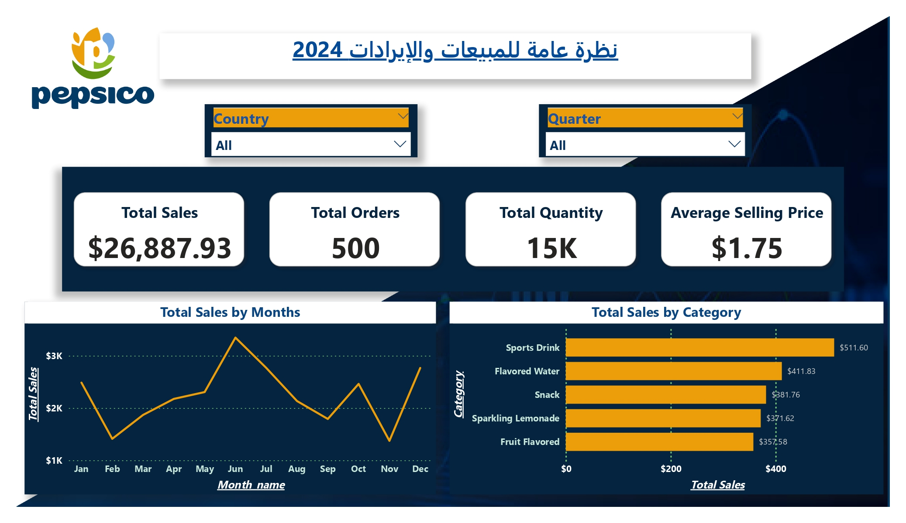

# 📊 PepsiCo Sales Performance Dashboard (2024)

## 📌 Overview
An interactive 6-page Power BI dashboard analyzing PepsiCo's overall sales, regional distribution, product category performance, customer buying behavior, and shipping operations.

---

## 🛠️ Key Features & Pages
1. **Overview:** Executive KPIs ($26.8K+ Sales, 500 Orders), monthly trends, and high-level category distribution.
2. **Sales Analysis:** Geographical insights across Middle East countries and quarterly performance (Q1–Q4).
3. **Products & Categories:** Deep dive into product metrics, financial vs. volume distribution, and Top/Bottom performers.
4. **Customer Analysis:** Behavioral analysis focusing on Top 10 customers by revenue, quantity, and order count.
5. **Shippers Analysis:** Shipping partner performance and order fulfillment metrics.
6. **Details:** Decomposition Tree and detailed tabular report with conditional formatting.

---

## 📁 Repository Contents
* `PepsiCo_Sales_Dashboard.pbix`: Power BI source file.
* `PepsiCo_Sales_Dashboard.pdf`: Complete multi-page PDF export.
* `Screenshots/`: High-resolution preview images for each dashboard page.

---

## 💻 Tech Stack & Tools
* **BI Tool:** Microsoft Power BI Desktop & Power BI Service
* **Data Transformation:** Power Query
* **Data Modeling:** Star Schema Model (Calendar, Customers, Products, Shippers, Invoices)
